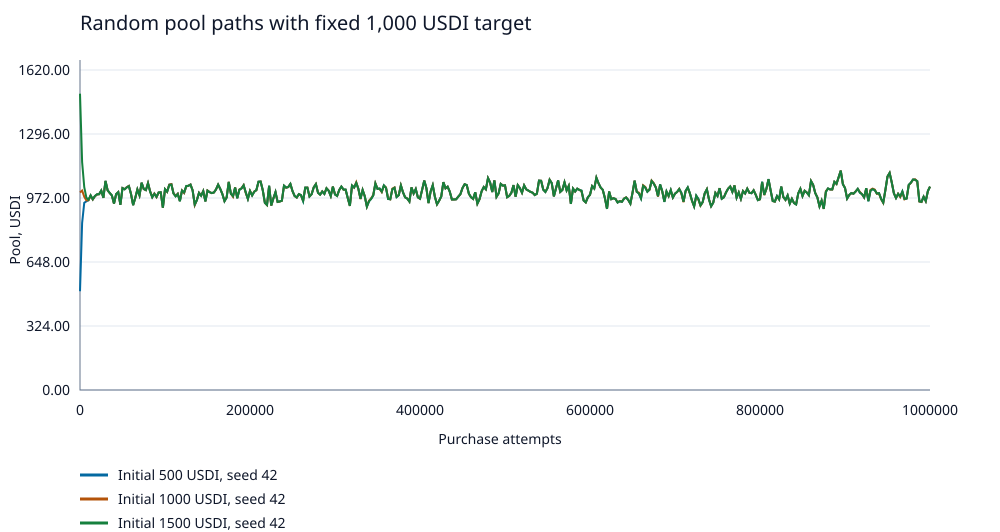
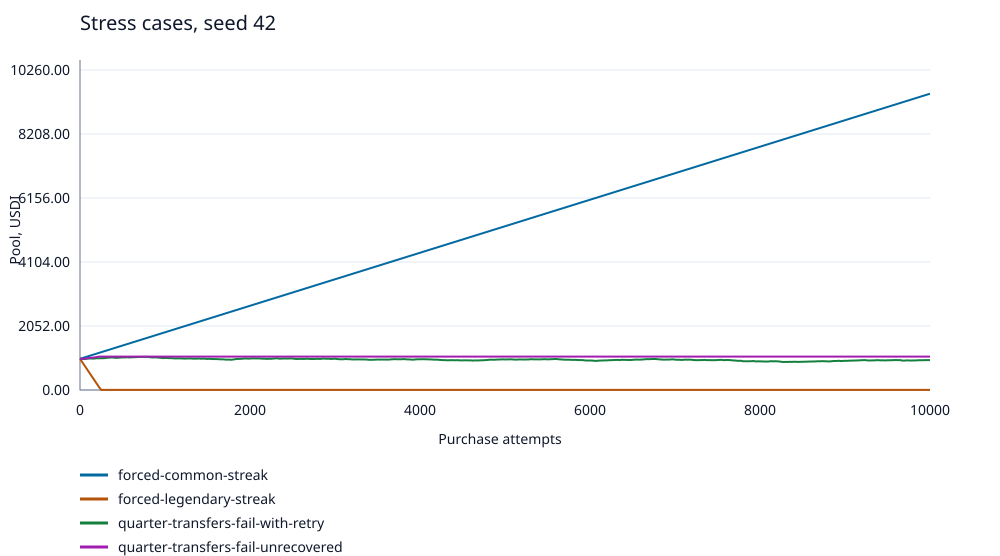
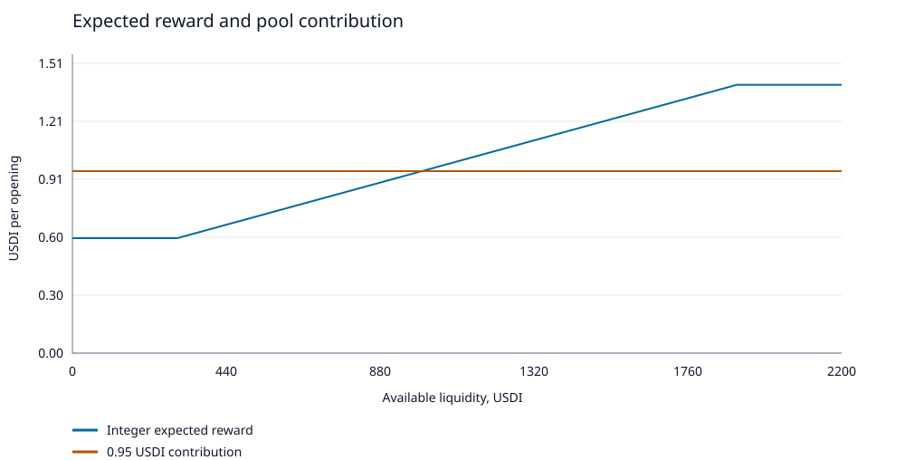

# USDI pool simulation report

This deterministic offline model runs 84 scenarios and 13492200 purchase attempts with seeds 1, 7, and 42. All 53697455 transition invariant checks passed. The full requested volume grid includes 100, 1,000, 10,000, 100,000, and 1,000,000 attempts.

USDI has no USD backing and no real monetary value. The model does not execute deployed contracts or prove their receipt behavior. Contract unit and integration tests cover implementation behavior separately.

## Model and financial proofs

The shared formula bounds A at 2,000 USDI before arithmetic. Both curves are constant beyond that point. It computes the clamped target EV, floors the rare probability, and assigns the remainder to common. Every tier stays positive and the probabilities sum to 1,000,000. The rare floor loses less than 0.9 token base units of EV. The target floor loses less than one more base unit, so the continuous-curve error is below 1.9 base units. At A=1,000 USDI, the actual EV is 0.9499998 USDI. The contribution is 0.95 USDI, so the rounded equilibrium has a 0.0000002 USDI upward drift per accepted opening at that point.

Acceptance increases P by 0.95 USDI and L by 5 USDI only when the new pool covers every reservation. The pre-payment minimum A is 5 USDI. The draw replaces the maximum reservation with the immutable reward. A successful callback decreases both P and L by that reward. A failed transfer changes neither P nor L. Fees stay outside P and vest only after a successful payout. Each transition checks P>=L, reservation totals, account uniqueness, fee allocation, and token conservation. During a transfer, cash plus the in-flight amount equals P plus all fee balances.

The target remains 1,000 USDI when the user population grows from 1,000 to 5,000. Sequential users do not change the probability formula. Each account has at most one unresolved opening. Healthy, Caution, and Critical states admit at most 64, 16, and 4 pending openings respectively. Existing reservations remain valid after a health downgrade.

SplitMix64 and unbiased rejection sampling supply simulation-only draws. Payout failures use an independent seeded stream. Recovered-failure scenarios retry the stored reward up to 32 times. Unrecovered failures retain their full reward liability and unvested fee. The model never times out an in-flight payment. Forced streaks deliberately override sampled outcomes and are adverse or favorable stress cases, not probability estimates.

## Random pool paths

The table uses the longest random run for seed 42 at each reserve level. Amounts are USDI. The JSON and CSV files contain every seed, volume, stress case, and raw base-unit metric.

| Initial pool | Users | Attempts | Accepted | Rejected | Final pool | Minimum | Maximum | Mean | Median | Average reward |
| ---: | ---: | ---: | ---: | ---: | ---: | ---: | ---: | ---: | ---: | ---: |
| 500 | 1000 | 1000000 | 1000000 | 0 | 1029.500000 | 500.000000 | 1134.750000 | 997.758554 | 997.800000 | 0.949470 |
| 1000 | 1000 | 1000000 | 1000000 | 0 | 1029.500000 | 882.950000 | 1135.150000 | 998.802932 | 998.000000 | 0.949971 |
| 1500 | 1000 | 1000000 | 1000000 | 0 | 1029.500000 | 882.550000 | 1500.950000 | 999.833866 | 998.300000 | 0.950470 |
| 1000 | 5000 | 1000000 | 1000000 | 0 | 1029.500000 | 882.950000 | 1135.150000 | 998.802932 | 998.000000 | 0.949971 |

## Stress cases

| Scenario | Seed | Accepted | Rejected | Maximum pending | Failed transfers | Pending | Liabilities, USDI | Pending fees, USDI | Vested fees, USDI |
| --- | ---: | ---: | ---: | ---: | ---: | ---: | ---: | ---: | ---: |
| forced-common-streak | 42 | 10000 | 0 | 1 | 0 | 0 | 0.000000 | 0.000000 | 500.000000 |
| forced-legendary-streak | 42 | 246 | 9754 | 1 | 0 | 0 | 0.000000 | 0.000000 | 12.300000 |
| unfunded-pool | 42 | 0 | 10000 | 0 | 0 | 0 | 0.000000 | 0.000000 | 0.000000 |
| healthy-concurrency | 42 | 64 | 936 | 64 | 0 | 0 | 0.000000 | 0.000000 | 3.200000 |
| caution-concurrency | 42 | 16 | 984 | 16 | 0 | 0 | 0.000000 | 0.000000 | 0.800000 |
| critical-concurrency | 42 | 4 | 996 | 4 | 0 | 0 | 0.000000 | 0.000000 | 0.200000 |
| quarter-transfers-fail-with-retry | 42 | 10000 | 0 | 1 | 3399 | 0 | 0.000000 | 0.000000 | 500.000000 |
| quarter-transfers-fail-unrecovered | 42 | 220 | 9780 | 64 | 64 | 64 | 46.900000 | 3.200000 | 7.800000 |

A long legendary streak exhausts available liquidity and causes full rejection of later purchases. The reserve rule prevents accepting an unfunded reward. Failed claims can fill account and concurrency slots; the model preserves their funding rather than treating their tokens as available pool liquidity. A common-only streak grows the pool and demonstrates that probabilities clamp without overflow.

## Empirical and expected frequencies

Expected frequencies average the frozen quote probabilities across accepted openings. They are not the probabilities at the final reserve. Actual frequencies count draws, including rewards that remain unpaid after transfer failure.

| Initial pool, USDI | Users | Common actual / expected | Rare actual / expected | Legendary actual / expected | Expected average reward, USDI | Health transitions |
| ---: | ---: | ---: | ---: | ---: | ---: | ---: |
| 500 | 1000 | 0.277295 / 0.278035 | 0.672946 / 0.672187 | 0.049759 / 0.049778 | 0.948879 | 67 |
| 1000 | 1000 | 0.277175 / 0.277911 | 0.672968 / 0.672208 | 0.049857 / 0.049880 | 0.949401 | 0 |
| 1500 | 1000 | 0.277055 / 0.277797 | 0.672990 / 0.672220 | 0.049955 / 0.049983 | 0.949917 | 0 |
| 1000 | 5000 | 0.277175 / 0.277911 | 0.672968 / 0.672208 | 0.049857 / 0.049880 | 0.949401 | 0 |

## Faucet duplication model

This separate model keeps claim eligibility after token registration is removed. Faucet issuance never automatically adds backing to the case pool. These results check the model's state rule, not a deployed faucet.

| Users | Claim attempts | Accounts minted | Duplicate attempts rejected | Total minted, USDI | Unregister then reclaim rejected |
| ---: | ---: | ---: | ---: | ---: | --- |
| 1000 | 10001 | 1000 | 9001 | 1000000 | true |
| 5000 | 50001 | 5000 | 45001 | 5000000 | true |

## Data definitions and limits

`results.json` contains full scenario configuration, counts, frequencies, liabilities, fees, sampled paths, and all requested pool statistics. `metrics.csv` contains one row per scenario. `traces.csv` downsamples paths to about 400 intervals per scenario. Money columns use exact USDI base units unless their name denotes an average. Floating point is used only for reported averages, frequencies, and graph coordinates. Ledger transitions and probability calculations use integers.

Pool mean and median use the initial pool, the pool after each purchase attempt and its scheduled batch settlements, and the final pool after the last batch. Minimum and maximum include every checked ledger transition, including payment acceptance before payout. Health sample counts cover the end of each attempt. Health transitions count every checked ledger transition, including temporary reservation pressure. Attempt counts include rejected purchases; accepted volume can be lower under insolvency, concurrency, or unpaid-claim pressure. No fees are withdrawn during these runs.

The simulation supports expected mean reversion, not a solvency or return guarantee. Finite samples can have large drawdowns. Protocol randomness in the actual Testnet demonstration is not a VRF. Validator ordering, withholding, and retry timing can affect outcomes. The simulation PRNG does not model those attacks, asynchronous latency, stale quotes, gas exhaustion, storage costs, transaction fees, or network throughput. A successful model run cannot establish production fairness or receipt safety. No parameters are tuned to improve these results.

Regenerate the full artifacts from the repository root with `cargo run --release --manifest-path contracts/Cargo.toml -p iroh-economics --bin simulate -- --output .`. Add `--quick` only to check artifact generation with smaller volumes. The generator writes only `docs/usdi-pool-simulation-report.md` and `docs/usdi-simulations/`.
